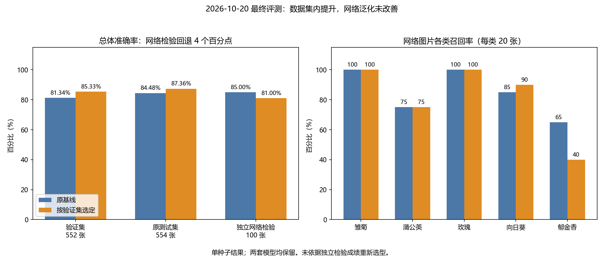

# 2026-10-20 模型改进实验

## 预先确定的比较规则

基线是 `outputs/experiment-002/best.pt`：手写 ResNet-18、30 轮、随机种子 42、224 像素输入、批大小 32、AdamW 初始学习率 0.0003、余弦调度，验证准确率 81.34%。基线训练配置、数据清单和权重保留。

第一批实验登记在 `configs/ablation-20261020.json`。保持数据划分、轮数、随机种子、网络与优化器一致，每项只改变一个主要因素：

| 实验 | 改变的因素 | 其余参数 |
| --- | --- | --- |
| augmentation | 原有增强基础上增加温和随机缩放裁切、对比度与饱和度扰动 | 与基线相同 |
| label-smoothing | 交叉熵标签平滑从 0 改为 0.1 | 与基线相同 |
| weight-decay | AdamW 权重衰减从 0.0001 改为 0.001 | 与基线相同 |

验证损失统一使用不含标签平滑的交叉熵，便于比较；平滑实验的训练损失本身不可与原始训练损失直接等同。每轮额外记录验证宏平均 F1，选择规则为验证准确率优先，宏平均 F1 用于辅助比较。第一批不启用早停，保证轮数一致。

每个实验从随机初始化开始，保存单独的权重、配置、训练曲线、UTF-8 终端日志和数据清单哈希。先完成单因素实验，再根据验证结果确定是否组合；补充训练数据作为后续独立因素比较。不会事先假定每项改动都有帮助。

现有测试集结果已经查看，不用其结果调参。新增外部检验图片在训练和选型前固定清单与哈希，仅在方案确定后进行最终评估。若数据源与原数据集存在相同内容或近似重复，应先排除，并记录排除原因。

## 第一批实测结果

| 实验 | 最佳轮次 | 最佳验证准确率 | 对应验证宏平均 F1 |
| --- | --- | --- | --- |
| 原基线 | 30 | 81.34% | 0.8121 |
| 增强 | 28 | 84.06% | 0.8383 |
| 标签平滑 0.1 | 30 | 82.43% | 0.8207 |
| 权重衰减 0.001 | 21 | 81.88% | 0.8180 |

三个实验都完成全部 30 轮。增强比原基线增加约 2.72 个百分点，当前收益最明显；权重衰减的提升只有约 0.54 个百分点，单个种子不足以证明稳定提升。

第二批计划登记在 `configs/combinations-20261020.json`：先在增强上加入标签平滑，再在这个组合上增加权重衰减，每个相邻比较只增加一个因素。仍使用相同数据划分、种子与 30 轮；尚未使用外部检验结果选择方案。

第二批均完成 30 轮：增强＋标签平滑的最佳验证准确率 85.33%，宏平均 F1 0.8510，对应第 28 轮；再增加权重衰减后为 84.60%，F1 0.8441，对应第 29 轮。当前采用增强＋标签平滑作为补充数据实验的对照，仍使用原权重衰减 0.0001。

## 图片来源与检查结果

通过 Wikimedia Commons 查询文件元数据，记录逐图页面、作者、许可、下载地址、文件哈希和人工检查结果。只使用可明确对应五类花卉且许可清楚的图片。补充训练针对玫瑰和郁金香，外部检验覆盖五个类别；按作者分组，并排除发现的近似连拍照片。

已查询并下载 347 张候选图片：玫瑰 131 张、郁金香 66 张，其余三类各 50 张，下载无失败。每位作者每类最多保留 12 张候选，以减少单一摄影者主导来源；所有入选图片均经过像素/感知哈希检查与逐图人工复核。

字节、解码像素和感知哈希比较后保守排除 6 张；逐图查看 341 张联系表图像，进一步排除 84 张标签错误、图画、主体信息不足或近似连拍照片。特别注意 `Hibiscus rosa-sinensis` 属于扶桑，学名中的 rosa 不能用作玫瑰标签。

剩余 257 张已检查图片中，固定 100 张外部检验图，每类 20 张；按全局作者分组与补充训练数据隔离。新增训练图片为玫瑰 45 张、郁金香 33 张，共 78 张，因此训练集由 2562 增至 2640。另 79 张不进入本轮训练与外部检验，防止为凑数量破坏作者分组。

来源与署名、检查决定、固定划分和文件哈希分别保存在 `data_provenance/`。第三批计划是 `configs/enriched-20261020.json`，只比较是否增加这 78 张训练图。原验证集的 552 张样本保持相同，不用外部检验挑选方案。

## 最终验证集选择（独立检验前固定）

第三批同样完成 30 轮，最佳模型在第 24 轮：验证准确率 85.33%，宏平均 F1 0.85185。它与不补图组合的验证准确率相同，F1 仅略高于 0.85101，因此补图的收益有限，不能声称显著提高准确率。

按预先规定的“验证准确率优先、平分时比较宏平均 F1”规则，固定 `augmentation-smoothing-enriched/best.pt` 作为本轮选定模型，完整路径和权重哈希登记在 `configs/selected-model.json`。原验证集从正确识别 449/552 增至 471/552，提高 3.99 个百分点。

全部单因素和递进组合结果见 `docs/improvement-20261020-results.csv`，对照图为 `docs/assets/improvement-20261020-comparison.png`。这仍是同一个种子 42 的初步实验，细小差异可能来自随机波动；独立检验不再用于调整本次选型。

所有新增下载、清单与模型输出保存在本 E 盘项目中。原始图片不提交至 Git；可复现的代码、配置、来源说明、来源与署名清单和实验总结持续提交。

## 最终评测：原测试集提升，独立网络检验回退

提交 `2615551` 已固定选型，随后才运行两个模型的独立网络检验。选型保持不变，没有根据检验结果重新挑选模型。六个新实验全部训练 30 轮；最终使用增强、标签平滑 0.1、78 张补图，权重衰减仍为 0.0001。组合中把权重衰减提高到 0.001 会降低验证成绩，因此未采用。

| 评测集合 | 原基线正确数 / 准确率 | 本轮选定模型正确数 / 准确率 | 准确率变化 | 宏平均 F1：原 → 新 |
| --- | --- | --- | --- | --- |
| 原验证集，552 张 | 449 / 81.34% | 471 / 85.33% | +3.99 个百分点 | 0.8121 → 0.8518 |
| 原测试集，554 张 | 468 / 84.48% | 484 / 87.36% | +2.89 个百分点 | 0.8417 → 0.8726 |
| 独立网络检验，100 张 | 85 / 85.00% | 81 / 81.00% | **−4.00 个百分点** | **0.8465 → 0.7952** |



本轮改善了原数据集内的表现，**没有证明网络图片的泛化改善**。两套权重均保留，默认预测使用按验证集预先选定的模型，也可显式指定原基线作对照。补图前后的验证准确率均为 85.33%，仅 F1 从 0.85101 到 0.85185；不能把这个小差异描述为补图显著有效。

| 类别 | 原测试集：原 → 新正确数 | 网络检验：原 → 新正确数 |
| --- | --- | --- |
| 雏菊 | 86/96 → 85/96 | 20/20 → 20/20 |
| 蒲公英 | 115/135 → 125/135 | 15/20 → 15/20 |
| 玫瑰 | 67/97 → 80/97 | 20/20 → 20/20 |
| 向日葵 | 97/106 → 101/106 | 17/20 → 18/20 |
| 郁金香 | **103/120 → 93/120** | **13/20 → 8/20** |

原测试集上玫瑰的召回率从 69.07% 升到 82.47%，但郁金香从 85.83% 降到 77.50%。网络检验中，新模型将 20 张郁金香中的 10 张判为玫瑰、1 张判为雏菊、1 张判为向日葵；玫瑰的召回率虽仍是 100%，精确率从 80% 降到 66.67%。这说明不能只看总分或“玫瑰都识别正确”，还要检查其他类别是否被错误吸收到玫瑰类。

外部检验包含 48 个署名作者字段，新增训练包含 43 个，字段无交集；外部每类作者数分别为 14、16、5、15、15。玫瑰仅来自 5 个作者，且不同账号不一定是不同自然人。100 张是小规模、人工筛选样本，单种子训练的这次差异不能直接推广到所有网络图片，也未证明统计显著性。

下一轮应另建覆盖五类、来源更分散的外部验证集，用它检查裁切强度、类别边界及训练比例，并比较多个随机种子。再预留一批全新的最终测试图；本次已查看的 100 张只能作为历史检查。可专门补充郁金香花形、花苞和不同背景的样本，但不能围绕这 100 张的错误反复改模型后继续声称它们是未见检验集。

可复查数据见 `docs/final-evaluation-20261020.csv`、`docs/final-evaluation-20261020-classes.csv` 和 `docs/final-evaluation-20261020-evidence.json`。本地各评估目录保留逐图预测、混淆矩阵和指标；报告脚本核对已有结果、权重和清单哈希，不触发训练或重新选型：

```powershell
& $python -s scripts/report_final_evaluation.py
```

## 知识点

数据增强在保留类别语义的前提下改变训练图片；标签平滑减轻模型过度确信某一个类别；权重衰减限制参数幅度。这些措施都需要实际验证，不能保证对每个数据集有效。单因素对照帮助判断变化来自哪里，同一个种子的结果仍属于初步证据。

召回率回答“真实属于这一类的图片识别对了多少”；精确率回答“被判成这一类的图片有多少是对的”；宏平均 F1 对各类等权汇总，避免只看总体准确率。验证集用于做选择，独立检验用于检查选择是否能推广；当检验暴露回退时应记录这个结果，并为后续改进准备新的独立评估。
